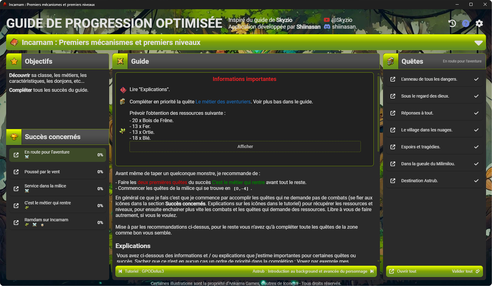

# GPODofus3 - Guide de Progression Optimisée Dofus 3

[](https://www.gnu.org/licenses/gpl-3.0)
[](https://github.com/AnthoB-Dev/GPODofus3/releases)
[](https://github.com/AnthoB-Dev/GPODofus3/releases)



Application desktop pour suivre votre progression dans Dofus, basée sur le guide de progression optimisée de Skyzio.

**⚠️ Outil non-officiel** - Cette application n'est pas affiliée à Ankama Games.

---

## 🎯 Fonctionnalités principales

### 📊 Gestion de progression
- **Profils multi-personnages** - Créez plusieurs profils avec plusieurs personnages chacun
- **Suivi des quêtes et succès** - Validez votre progression au fur et à mesure
- **Système de donjons** - Suivez la complétion des donjons pour chaque personnage
- **Alignements et branches** - Gérez les alignements, ordres et choisissez vos branches de quêtes lorsqu'il y en a (progression à choix multiples)

### 🎨 Interface moderne
- **Plein de thèmes disponibles** - 7 thèmes Dofus + 7 thèmes originaux (dans les deux cas disponibles en versions claire et sombre)
- **Navigateur intégré** - Consultez les liens directement dans l'application
- **Historique de navigation** - Naviguez facilement entre les guides consultés
- **Drag-to-validate** - Glissez-déposez pour valider vos quêtes rapidement

### 💾 Sauvegardes
- **Sauvegardes automatiques** - Backup automatique à chaque fermeture
- **Sauvegardes manuelles** - Créez vos propres points de sauvegarde
- **Restauration facile** - Restaurez une sauvegarde en quelques clics

### 🔄 Mises à jour
- **Mise à jour automatique** - L'application vérifie automatiquement la version à chaque lancement et propose la mise à jour

## 📦 Installation

### Windows

1. Rendez-vous sur la page [Releases](https://github.com/AnthoB-Dev/GPODofus3/releases)
2. Téléchargez le fichier `.exe` de la dernière version
3. Lancez l'installateur et suivez les instructions
4. L'application est prête à être utilisée !

### Linux

1. Rendez-vous sur la page [Releases](https://github.com/AnthoB-Dev/GPODofus3/releases)
2. Téléchargez le fichier `.AppImage` ou `.deb` selon votre distribution
3. Pour AppImage : Rendez le fichier exécutable puis lancez-le
   ```bash
   chmod +x GPODofus3_*.AppImage
   ./GPODofus3_*.AppImage
   ```

**Note** : Certaines fonctionnalités sont limitées sur Linux (pas de navigateur intégré, ni désinstallateur intégré).

---

## 🎮 Utilisation

### Navigation

- **📖 Menu des guides** - Cliquez sur l'icône livre ou le titre du guide en haut pour accéder à tous les guides disponibles
- **✅ Validation** - Glissez-déposez les boutons de validation pour marquer vos quêtes comme terminées
- **🏆 Succès** - Cliquez sur un succès pour afficher ses quêtes associées
- **⬅️ ➡️ Navigation** - Naviguez entre les guides avec les flèches du clavier ou l'historique
- **⚙️ Paramètres** - Accédez aux profils, thèmes, sauvegardes et mentions légales

### Sauvegardes

Les sauvegardes sont stockées localement dans :
```
- **Windows** : `%APPDATA%/GPODofus3/saves/`
- **Linux** : `~/.local/share/GPODofus3/saves/`
```

- **Automatiques** : Créées à chaque fermeture (10 dernières conservées)
- **Manuelles** : Créez vos propres sauvegardes via le menu Paramètres > Sauvegarde

### Support et questions

- 📋 [Issues GitHub](https://github.com/AnthoB-Dev/GPODofus3/issues) - Signalez un bug ou proposez une amélioration
- 📖 Tutoriel intégré - Accessible depuis le menu Paramètres

---

## 📄 À propos

### Licence

Cette application est **gratuite** et **open source** sous licence GPL-3.0.

Le code source est librement accessible et modifiable. Si vous créez une version modifiée, vous devez :
- Créditer l'auteur original (AnthoB-Dev)
- Partager votre code source
- Utiliser la même licence GPL-3.0

📜 [Voir la licence complète](LICENSE)

### Mentions légales

**Important** : Cette application utilise des ressources graphiques (icônes de classes, logos de serveurs) qui sont la propriété d'**Ankama Games**. Ces éléments visuels ne sont PAS couverts par la licence GPL-3.0 et restent la propriété exclusive d'Ankama.

Cette application est développée de manière indépendante et **n'est pas affiliée à Ankama Games**.

⚖️ [Mentions légales complètes](LEGAL.md)

### Confidentialité

**Aucune donnée personnelle n'est collectée.** Cette application fonctionne entièrement en local sur votre ordinateur.

- 🔒 **Pas de connexion Internet requise** - L'app fonctionne sans connexion (sauf mises à jour et navigateur intégré)
- 🔒 **Pas de télémétrie** - Aucune donnée n'est envoyée à des serveurs externes
- 🔒 **Données 100% locales** - Toutes vos informations restent sur votre machine dans `%APPDATA%\GPODofus3`

Vos données de progression vous appartiennent et restent strictement privées.

### Crédits

- **Skyzio** - Auteur du guide de progression original
- **Ankama Games** - Créateurs de Dofus
- **Icons8** & **FontAwesome** - Icônes
- **Anthropic Claude** - Assistance au développement

---

**⚠️ Disclaimer** : GPODofus3 est un outil de suivi non-officiel pour le jeu Dofus. Il n'est pas affilié, endorsé, sponsorisé ou approuvé par Ankama Games.
